# Domain Enumeration

After we have compromised a domain, we can begin further domain enumeration. Doing so will provide us with high value targets for further attacks, such as:
* Domain Administrator accounts
* Enterprise Administrator accounts
* Domain User accounts
* Computers in the domain
* Possible passwords (if included in the *description* of a user/computer)

Here we will enumerate our domain using four tools:
* [ldapdomaindump](https://www.kali.org/tools/python-ldapdomaindump/)
* [Bloodhound](https://www.kali.org/tools/bloodhound/)
* [Plumhound](https://github.com/PlumHound/PlumHound)
* [PingCastle](https://github.com/netwrix/pingcastle)

## VMs Involved in the Attack
In our scenario, we will have **two** VMs running at the same time:
* Kali Linux (later referred to as Attacker VM)
* Windows Domain Controller

For *PingCastle*, we need to run one of the **Windows 11 user machines** instead of the Kali Linux VM.

## Attack Method 1: Using ldapdomaindump
### Attack Setup
Before starting this attack, create a new directory on the attacker VM where all enumerated data will be saved. In my case, I created `\MEDDLING.local`

### Launching the Enumeration Attack
If inside the newly created directory, run ldapdomaindump using the command: `sudo ldapdomaindump ldaps://[DOMAIN CONTROLLER IP] -u ‘[DOMAIN]\[USERNAME]’ -p [USER PASSWORD]`

If not inside the newly created directory, run ldapdomaindump with the **-o** flag to send the command output to the provided directory:
`sudo ldapdomaindump ldaps://[DOMAIN CONTROLLER IP] -u ‘[DOMAIN]\[USERNAME]’ -p [USER PASSWORD] -o [DIRECTORY])`

If successful, the output should be:
```
[*] Connecting to host...
[*] Binding to host
[+] Bind OK
[*] Starting domain dump
[+] Domain dump finished
``` 

Enumerating my domain using *ldapdomaindump*:
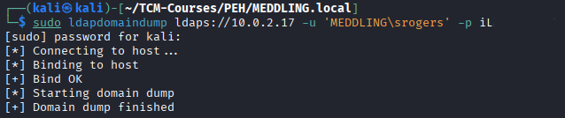

### Examining the Output

ldapdomaindump creates several output files in .html, .json, and .grep formats.

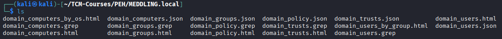

Two of the files are particularly useful in finding targets for further attacks: **domain_users_by_group** and **domain_computers**.

**Domain Users by Group**

The file *domain_users_by_group* lists all domain users based on their group membership, including Domain Admins, Enterprise Admins, and Group Policy Creator Owners. This information is useful when trying to gain access to an account with higher privileges.

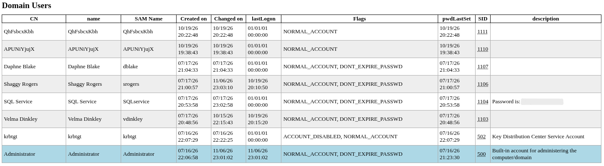

---

**Domain Computers**

The file *domain_computers* lists all hosts in the domain, providing us their hostname, OS name & version, as well as the last logon time. This information is useful when trying to move laterally through the network.

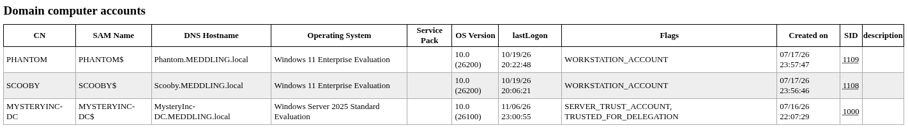

## Attack Method 2: Using Bloodhound

Bloodhound is a tool that provides us with graphs to reveal relationships within an Active Directory environment.

Specter Ops has an introductory course for this tool called [BloodHound Basics](https://academy.specterops.io/bloodhound-basics) which provides instruction and labs on how to use this tool for attack path management.

### Attack Setup

Install bloodhound onto your attacker VM using the command `sudo apt update && sudo apt install -y bloodhound`.

Run the bloodhound startup script using the command `sudo bloodhound-setup`.

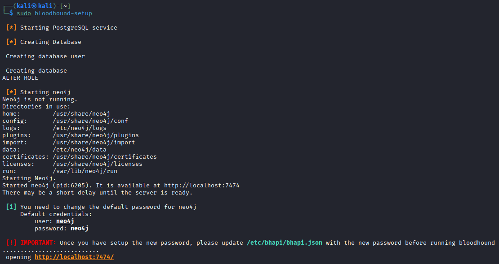

You will be brought to a *Neo4j* webpage, if not open a web browser and navigate to `http://localhost:7474`.

**Note: The neo4j service must be running in order to use Bloodhound.** In case you need to start the neo4j service, use the command `sudo neo4j console`.

Enter the default credentials for Neo4j: **neo4j:neo4j** and click *Connect*.

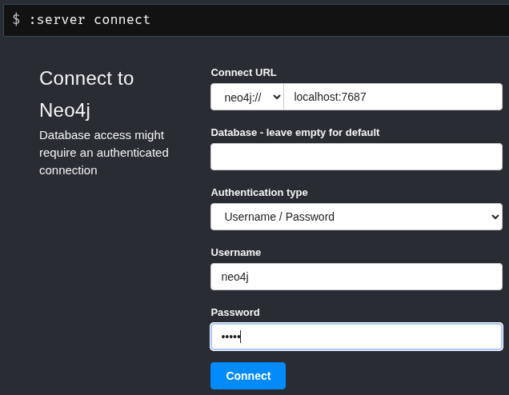

Now create a new password for *Neo4j* and click *Change password*. **Note: Remember what you set the password to, as you'll need to write it into the API config file /etc/bhapi/bhapi.json. PlumHound will also need this password in order to run later on.**

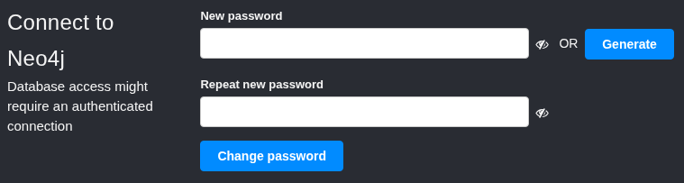

Edit the API config file */etc/bhapi/bhapi.json*, writing your new password in the **neo4j > secret** field.

Now you can start *bloodhound* using the command `bloodhound-start`, where you will be given the default credentials **admin:admin** to use in the Web UI at http://127.0.0.1:8080.

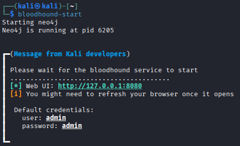

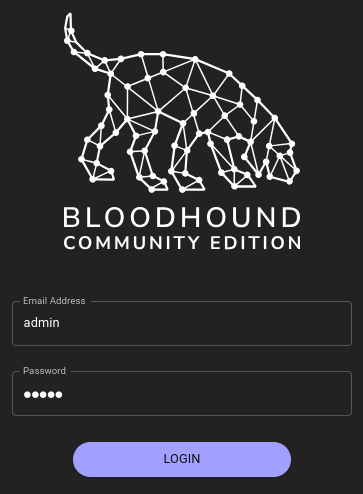

If you wish to change the default password, that can be found under **Profile > Authentication > Password**.

The final step before launching the attack is to create a new directory to save the tool's output: `mkdir [DIR NAME]`. I used the directory name **bloodhound**.

### Launching the Enumeration Attack
Now that the *Bloodhound* service is configured and running, we can have it ingest data from our domain using the command `sudo bloodhound-python -d [DOMAIN] -u [USERNAME] -p [USER PASSWORD] -ns [DOMAIN CONTROLLER IP] -c all`.

The *-c all* option tells bloodhound to **collect all information** that it can from our domain.

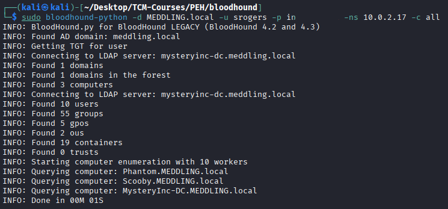

#### Troubleshooting

At first I had issues with bloodhound not being able to get a Kerberos TGT from the Domain Controller: 
```
INFO: Getting TGT for user
WARNING: Failed to get Kerberos TGT. Falling back to NTLM authentication. Error: [Errno Connection error (mysteryinc-dc.meddling.local:88)] [Errno -2] Name or service not known
``` 

I fixed the issue by making these changes:

* Editing the attacker VM's `/etc/hosts` file
* Editing the attacker VM's `/etc/resolv.conf` file

The line I added to `/etc/hosts` was: 
`[DOMAIN CONTROLLER IP] [DOMAIN CONTROLLER FQDN] [DOMAIN CONTROLLER SHORT NAME]`

`[IP] mysteryinc-dc.meddling.local mysteryinc-dc`

The lines I added to `/etc/resolv.conf` were:
```
nameserver [DOMAIN CONTROLLER IP]
search [DOMAIN NAME]
```

### Uploading the Output to Bloodhound Web Interface
Bloodhound creates several .json output files:

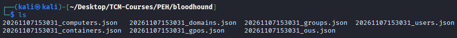

On the Bloodhound web page http://127.0.0.1:8080/ui/explore, click the **Quick Upload** button to upload all of our .json output files.

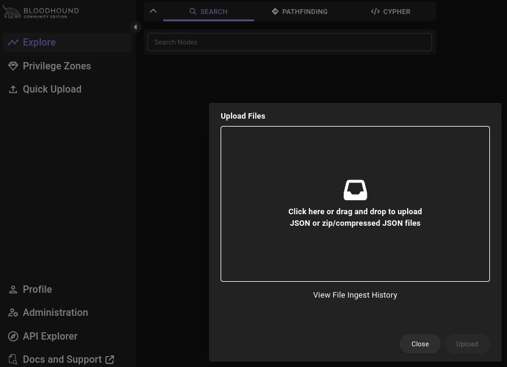

### Examining the Output in the Bloodhound Web Interface

We can open the **Explore** tab and **search** for useful information such as *domain admins*, which will provide us the DOMAIN ADMINS@[DOMAIN] and each of the members of that group.

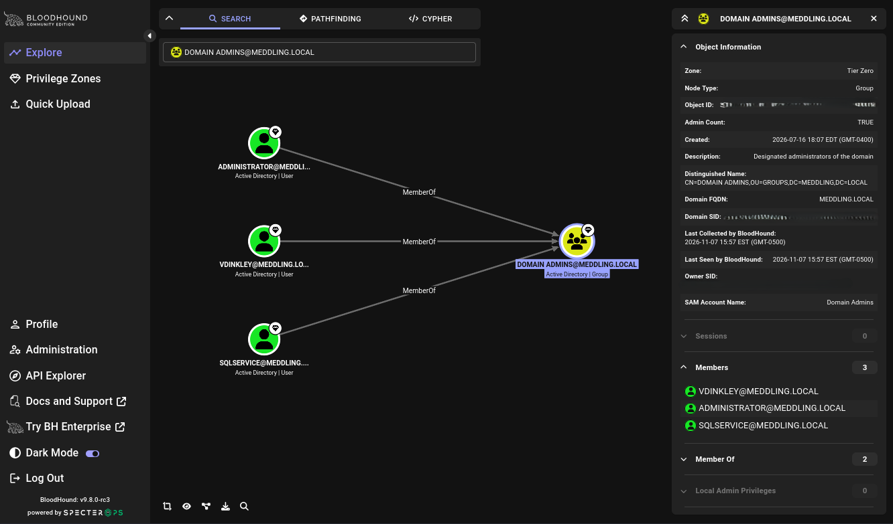

Using the **pathfinding** tools we can find potential paths between two nodes in the domain, visually showing relationships between objects along the way:

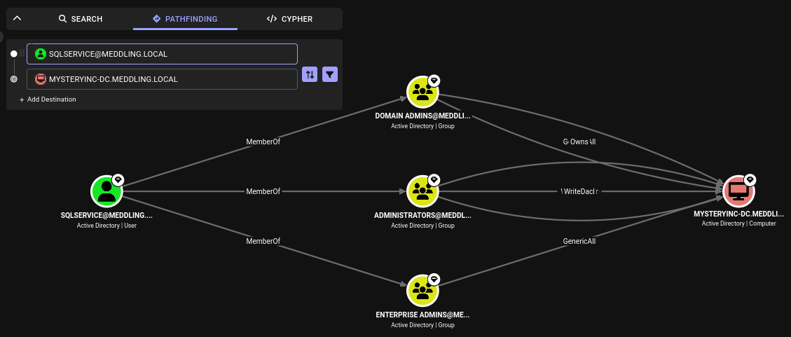

Bloodhound can also run queries inside your enumerated domain, to gain more insight about the environment. The full list of queries can be found in their [Query Library](https://queries.specterops.io/).

To stop the *bloodhound* service, use the command `bloodhound-stop`.

## Attack Method 3: Using PlumHound

PlumHound is a tool that uses BloodHound's pathfinding engine and cyber queries to generate consumable reports containing its findings. 

### Attack Setup

To install PlumHound on your attacker VM, follow these steps:
1. Clone the repository: `git clone https://github.com/PlumHound/PlumHound.git`
2. Create a new venv to install & use PlumHound: `python -m venv .venv` & `source .venv/bin/activate`
3. Install requirements inside PlumHound directory: `pip3 install -r requirements.txt`

Before running any further PlumHound commands, make sure that **BloodHound** is currently running on your machine with `bloodhound-start`.

### Launching the Enumeration Attack
Now we can text connectivity with PlumHound. Execute the *easy* task to list all Active Directory user objects using the command `python3 PlumHound.py --easy -p [NEO4J PASSWORD]`.

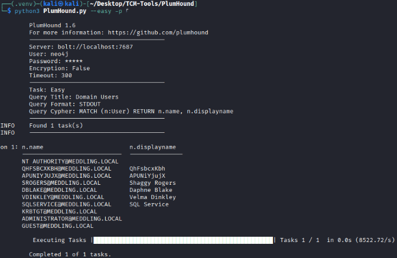

Upon task completion, you should see a list of domain users and their display names, along with "Completed 1 of 1 tasks".

Now we can run the *Default TaskList* using the command `python3 PlumHound.py -x tasks/default.tasks -p [NEO4J PASSWORD]`.

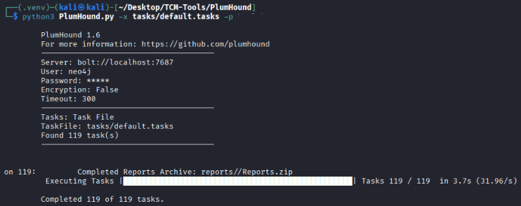

Executing the default task list will create reports in the **/PlumHound/reports** directory.

### Examining the Output

PlumHound creates reports in .csv, .html and .zip formats. We can open the file **index.html** using a web browser to easily access and read all of the other output files. Using the command `firefox index.html` will open the **Full Report Details** page in the Firefox browser:

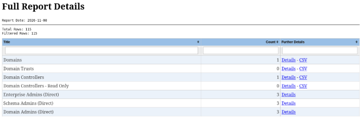

The *Full Report Details* page includes all reports generated by Plumhound, where the number of findings is shown in the *Count* column, and more detailed output can be found by clicking the *Details* or *CSV* buttons.

When clicking the *Details* button of the **Domain Controllers** finding, we can find more detailed information about the lone domain controller discovered. Here we see the *hostname*, *OS*, *Distinguished Name* (DN), and boolean flags showing whether the host is enabled and uses Local Administrator Password Solution (LAPS). 

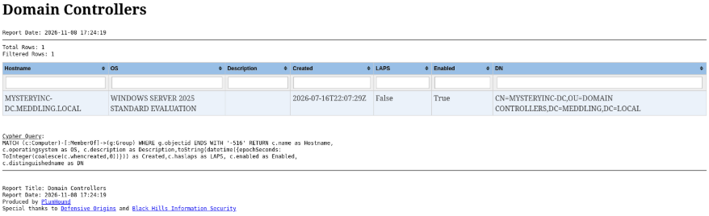

Useful reports to examine include:
* **Admin Groups** - lists administrative groups and their members
* **Kerberoastable Users** - lists all accounts that have a Service Principal Name (SPN) set and may be susceptible to kerberoasting attacks
* **GPOs** - lists all GPOs, which may highlight misconfigurations or incorrect permissions being granted
* **Hunt - Users with Pass or PW in Description** - lists all domain users whose *description* field contains a password

## Attack Method 3: Using PingCastle

PingCastle evaluates Active Directory security using a risk assessment methodology.

### Attack Setup

You'll need to download PingCastle onto one of the *Windows 11 user machines* as the tool is a Windows executable.

You can download the latest release from their [GitHub page](https://github.com/netwrix/pingcastle/releases). In order to download the tool from their main [website](https://www.pingcastle.com/), you need to provide a corporate email.

Extract the contents of the downloaded .zip file and execute the **PingCastle.exe** file.

### Launching the Enumeration Attack

Executing the **PingCastle** file should open a command prompt window:

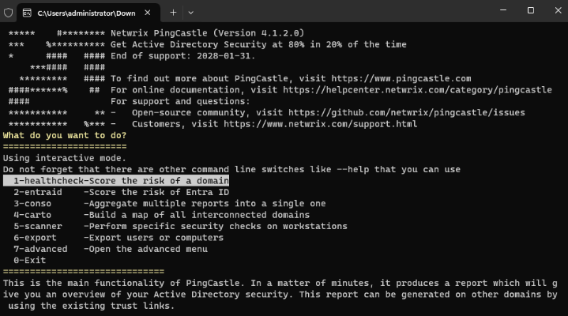

Run a *healthcheck* against your domain by pressing the *Enter* key. Next, you'll be asked if you want to use *privileged mode*. You can press *Enter* again to run without privileged mode.

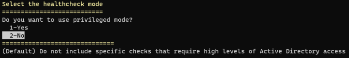

Lastly, you'll be asked to select a domain. Since we're running the tool on a machine already connected to a domain, our domain should appear as the default option. Pressing *Enter* one final time should start the tool.

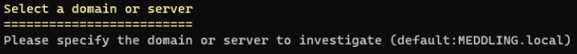

When successful, you should see output such as:
```
Getting domain information (MEDDLING.local)
Gathering general data
Gathering user data
...
Task Perform analysis for MEDDLING.local completed
```

### Examining the Output

PingCastle will create an .html output file named **ad_hc_[DOMAIN NAME]**. Opening this will bring us to the full results.

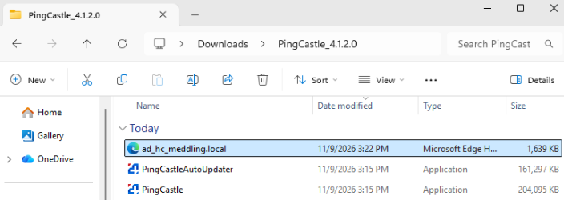

An overall *Domain Risk Level* will be provided under the **Indicators** list - which takes the worst (highest) score from the groups of rules analyzed.

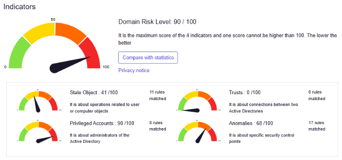

PingCastle also provides a **Risk Model** which color codes each risk based on its severity. Clicking on each risk in the table will give more details on the finding.

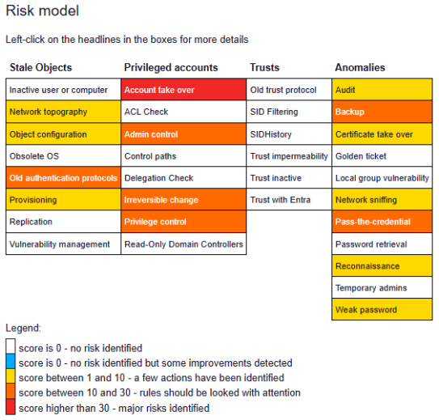

Examining the output, PingCastle provides a breakdown of each group of rules (Stale Objects, Privileged Accounts, etc.) and lists which rules matched and the score for each.

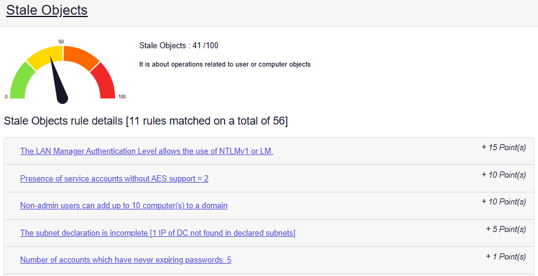

PingCastle also provides the same data as the other tools, such as *Domain Controller details*, *Admin Groups*, *Operating Systems*, etc.
